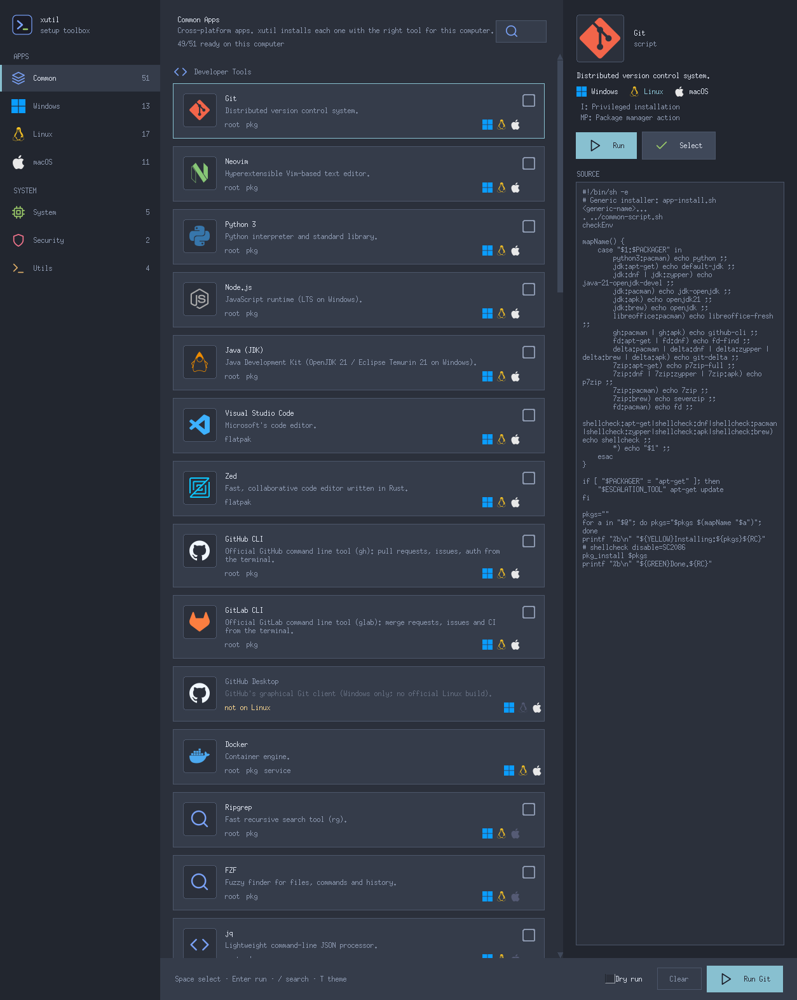
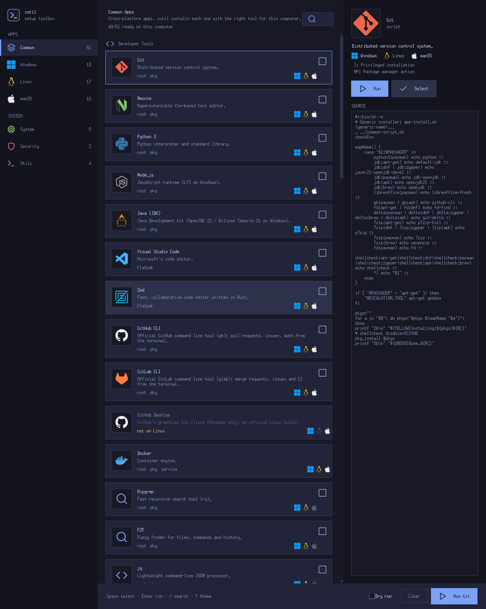

# xutil: apps and system setup for Windows, Linux and macOS

A cross-platform setup tool: a TOML catalog of scripts, filtered by preconditions for your system, browsed in a terminal UI or window, confirmed, then executed.

## Screenshots

| Main window | Task details |
|:---:|:---:|
|  |  |

## Run
Needs Python 3.11+.
```
Linux/macOS:  ./run.sh            (or python3 xutil.py)
Windows:      .\run.ps1           (or py xutil.py; use an Administrator terminal for admin tasks)
```

## Keys
`↑↓`/`j k` move, `→`/`Enter` open, `←`/`h` back, `Tab` next tab, `Space` select, `Enter` run (or `r` for the selection), `p` preview source, `/` search, `g` flag legend, `t` theme, `q` quit.

## Options
`-c FILE` config (`auto_execute`, `skip_confirmation`, `size_bypass`; TOML or JSON) · `-y` skip confirmation · `-u` show everything (unsafe) · `-s` ignore terminal size · `-r` skip root warning · `-t compatible` ASCII theme · `--list` · `--check` · `--dry-run`

Example config (works on both OSes because entries share display names):
```toml
auto_execute = ["Git", "Python 3", "System Update"]
skip_confirmation = true
```

## Layout
```
xutil.py                 engine + TUI
tabs/tabs.toml           tab order
tabs/<tab>/tab_data.toml catalog entries
tabs/common-script.sh    Linux helpers      tabs/common-script.ps1  Windows helpers
tabs/<tab>/*.sh|*.ps1    the actual tasks
```

## Add a task
Add an entry to a `tab_data.toml`, and drop a script next to it if needed:
```toml
[[data.entries]]
name = "Ripgrep"
description = "Fast recursive grep."
script = "app-install.ps1"
args = ["BurntSushi.ripgrep.MSVC"]
task_list = "WG"
[[data.entries.preconditions]]
matches = true
data = "os"
values = ["windows"]
```
Then run `python xutil.py --check`.

## Safety
Review anything with `p` (preview) or `--dry-run` first. Scripts that change the system ask or are marked with task flags; Docker's installer downloads and runs a remote script after asking.

## Single-file build
`python3 build-onefile.py out.py` bundles `xutil.py` and all of `tabs/` into one self-contained file. It unpacks the catalog to a temp folder on start and deletes it on exit. Edit the files under `tabs/`, then rebuild.

## Install (recommended)
```
Linux/macOS:  ./install.sh --run      (or: make install)      uninstall: ./install.sh --uninstall
Windows:      .\install.ps1 -Run                              uninstall: .\install.ps1 -Uninstall
```
Installs per user (no root, except to fetch missing Python/tkinter), adds an app-menu entry with the xutil icon, and a `xutil` command.

## Install from inside xutil
Open the window and click **Install xutil** in the sidebar (or press `i`): choose *Just for me* or *All users* (asks for your password on Linux/macOS, needs Administrator on Windows). Progress shows in the log. The same thing from a terminal, with no installer script needed, also from the single-file `dist/xutil.py`:
```
python3 xutil.py --install             # this user
sudo python3 xutil.py --install --system   # all users (Windows: Administrator terminal)
python3 xutil.py --uninstall-self [--system]
```

## Apps by platform
The window splits the app catalog into four sections (sidebar, **APPS**):
- **Common**: apps that exist on 2+ systems (Git, Firefox, VLC, VS Code ...). Pick one and xutil installs it with the right tool for the computer you are on: apt/dnf/pacman/Flatpak on Linux, winget/choco/scoop on Windows, Homebrew on macOS.
- **Windows**, **Linux**, **macOS**: apps that exist only there (PowerToys, Timeshift, Rectangle ...).
Each card shows three small logos for where the app exists. Apps that can't run on this computer stay visible but greyed out ("not on Linux") so you can browse the whole catalog; they can't be selected or run. A green dot marks the section for the system you are on.
macOS installs use `tabs/applications-setup/brew-install.sh` (needs Homebrew from https://brew.sh); entries are in `tab_data.toml` with `data = "os"`, `values = ["darwin"]`. An app with entries for 2+ OSes sharing the same `name` is shown once under Common; to add an app to a platform, add an entry with that OS precondition.
macOS and Windows entries were written from the Homebrew / winget / Chocolatey package names and were **not executed** here (Linux build host); Linux entries and the engine were.

## Windows quick start
1. Unzip, open PowerShell in the folder, run: `powershell -ExecutionPolicy Bypass -File .\install.ps1 -Run` (installs Python 3.12 with winget if you have none).
2. Open **xutil** from the Start Menu. For tasks that need Administrator, right-click it > Run as administrator, or use *Relaunch as Admin* in the sidebar.
3. No install: `py -3 xutil.py --gui`.
Notes: WhatsApp installs from the Microsoft Store (winget no longer carries it). *Microsoft Word* installs Microsoft 365 (needs your license). *Microsoft Word 2013* runs your own Office 2013 setup.exe/ISO (xutil never downloads or activates Office).

## Window app (Omarchy-style)
`xutil --gui` (the default when you start it from the menu): dark, keyboard-first, with a brand icon on every app.
- Sidebar tabs, a Walker-style search box that searches every tab, card grid grouped by category, detail panel with the script source, a queue/log window with per-task status and an input line for prompts.
- Install animation: while tasks run you get a spinning ring around the app icon, a smooth progress bar with a shimmer, a per-task queue with animated check marks, a timer, and a success or error finish. The log is under "Details" (click *hide* to collapse it).
- 8 themes: Omarchy (default on Omarchy — reads the active desktop theme at startup), Tokyo Night, Catppuccin, Gruvbox, Nord, Rose Pine, Kanagawa, Matte Black. Click the theme box (right-click = previous) or press `t`. Remembered in `~/.config/xutil/gui.json`; `--gui-theme NAME` overrides.
- Keys: arrows move, `Space` select, `Enter` run highlighted, `Ctrl+Enter` run selected, `/` or `Ctrl+K` search, `Esc` clear, `[` `]` or `1-4` switch tab, `t` theme.
- Fonts: uses JetBrainsMono Nerd Font / JetBrains Mono / Cascadia / DejaVu Sans Mono, whichever exists.
- Needs tkinter: Fedora `sudo dnf install python3-tkinter`, Debian/Ubuntu `sudo apt install python3-tk`, Arch `sudo pacman -S tk` (install.sh does this for you).

Icons: brand logos come from the `simple-icons` npm package (CC0) and the rest are original line icons, stored in `xutil_icons.py`. To change them edit `tools/make_icons.py` and re-run it (needs `rsvg-convert`). Map an app to an icon in `ICON_FOR` inside `xutil.py`.

Ready-made apps: push `xutil.py`, `xutil_icons.py`, `gui_entry.py` and `.github/workflows/build.yml` to GitHub (use the single-file build from `make onefile`, which already contains the icons), then run the **build** workflow in the Actions tab. It produces `xutil-Windows-app.exe`, `xutil-Linux-app` and terminal versions, no Python needed.
